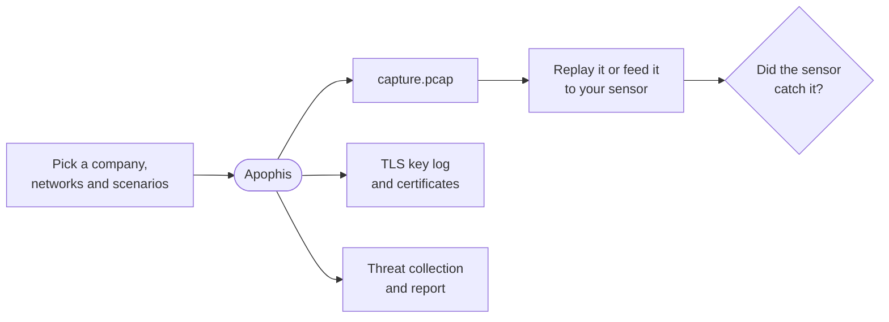

<div align="center">

<picture>
  <source media="(prefers-color-scheme: dark)" srcset="assets/gearhead-logo-dark.png">
  
</picture>

# Apophis-OG

### A fake company's whole workday, as a packet capture, with the attacks left in.

Synthetic network traffic for testing and demoing NDR and NPM tools.

[](LICENSE)
[](dev/requirements.txt)
[](#how-to-get-it)
[](dev/VERSION)

[What it is](#what-it-is) · [Get it](#how-to-get-it) · [Run it](#how-to-run-it) · [Use it](#what-you-can-do-with-it) · [Safety](#use-it-responsibly)

</div>

---

The company doesn't exist. Neither do its servers, employees, or printers. The packets are real, though, and so are the attacks hidden inside them. If your detection tool is any good, it will notice. If it isn't, you'll find out in a lab instead of during an incident.

> Apophis is the Egyptian serpent of chaos. This tool makes chaos on purpose, in your environment, with your permission, and at your request.

## What it is

Apophis is a traffic generator. You press a button, and it writes a `.pcap` file that looks like a full business day on a mid-sized network: people logging in, servers answering, backups running, DNS chattering, web apps being web apps. Then it adds the interesting parts, such as a ransomware run, a compromised appliance, a slow database, or a certificate about to expire.

People use it to test and demo network detection and response (NDR) and network performance monitoring (NPM) tools. You feed the capture to a sensor, then check whether the sensor saw what it should have seen.



| | |
|---|---|
| ✅ Protocol-correct | Everything is generated from scratch and follows the protocol rules. A checker, `dev/checks/check_rfc791.py`, verifies a capture independently. |
| 🔁 Repeatable | The same inputs give you the same shape of capture every time, so you can compare one test run with the next. |
| 🏠 Self-contained | The web interface runs only on `127.0.0.1` and nothing is sent in the background. It contacts GitHub when you click Update, and threat-feed publishers or your sensor when you ask it to. |

## What's in a capture

A capture is one ordinary business day plus whichever scenarios you pick. There are around 70 scenarios, in four flavors:

| Category | What it gives you |
|---|---|
| NDR | Attack-shaped traffic for detection testing |
| NPM | Performance problems such as slow servers and degraded links |
| Crypto | Certificate and encryption trouble |
| Incident replay | Reconstructions of publicly known vulnerabilities |

Under the hood there is a long list of protocols. You get the usual web, DNS, Kerberos and file-sharing traffic, plus industrial protocols such as EtherNet/IP, S7Comm and OPC UA, VPN and Wi-Fi authentication, and SNMP. There's also a smart board that quietly runs an MCP server in plaintext, because someone always does.

Next to the pcap you also get a TLS key log so you can decrypt the encrypted parts, the server certificates, a threat collection of the indicators used, and a report describing what was generated.

### Make it your own company

By default the fictional company is Example Logistics. You can swap in any name and industry. The Active Directory domain, Kerberos realm, host names, certificate authority and file names all follow along, so the capture stays consistent from top to bottom. You can also change the two main networks if your lab already uses 10.10.10.0/24 for something else.

### Campaign builder

Give Apophis a list of threat indicators, from a public feed, a pasted list or a file, and it assembles an attack campaign mapped to MITRE ATT&CK and writes it into the capture as real packets. It knows 50 network behaviors (beacons, scans, login attempts, transfers and so on) and 12 malware-family look-alike profiles. Nothing in it is an exploit, and every payload is inert.

It also produces a campaign report, an ATT&CK Navigator layer, a STIX bundle and a printable diagram.

> [!NOTE]
> By default, indicator addresses are remapped into `198.18.0.0/15`, a range reserved for network testing, and nothing is ever sent to the real indicator. Using the real addresses requires an explicit confirmation.

## How to get it

You have two options, and the first one needs no Python at all.

| | Best for | How |
|---|---|---|
| 🍎 **Mac app** | Just wanting it to work | Download the latest `.zip` from the Releases page, unzip it, and drag the app wherever you keep your apps. Apple Silicon only. |
| 🐍 **From source** | Any platform with Python | Clone this repository (below). |

> [!TIP]
> The Mac app is ad-hoc signed, so the first time on a new Mac you have to right-click it and choose Open. Gatekeeper is just being careful.

For the source route:

```bash
git clone https://github.com/GearheadSkunkworks/Apophis-OG.git
cd Apophis-OG/dev
pip install -r requirements.txt
```

The only dependency is the `cryptography` package, so Python 3.11 or newer is all you need.

## How to run it

With the Mac app, open it and you're done. It starts the same local web interface described below and shows it in your browser, with Python and everything else bundled inside. Everything in the rest of this section about the page itself applies to the app too. The one thing it doesn't include is `tcpreplay`, which you only need for replay (see below).

From source, start the local web interface:

```bash
python3 server.py
```

It opens http://127.0.0.1:8765 in your browser. If that port is busy, it moves up to 8766 and so on, and it tells you which one it picked. On a Mac you can also double-click `run.command`.

In the page, choose a scale and an output folder, pick the scenarios you want, and click Generate capture. When it finishes, "Reveal in folder" takes you to your files.

<details>
<summary><b>Prefer the command line? Click here.</b></summary>

<br>

I like your style. Weird choice, but I like it. You like doing easy stuff the hard way. You're a pour over coffee / loose tea / hand carving / meat smoking kinda human.  Graphics and flashy stuff just aren't as important.  Functionality may not be either, but hey it's your world to live in.  No judgement. A small quick run looks like this:

```bash
python3 opengenerator_build.py --scale 0.004 --out demo.pcap
```

A scale of 1.0 is the full day, which is big. Small scales are handy while you're getting the feel of it. Add `--list-modules` to see every scenario, `--only NDR` to build just one category, or `--company "Initech"` to rename the victim.

</details>

Replaying a capture onto a live interface uses `tcpreplay`, which isn't bundled:

```bash
brew install tcpreplay
```

You only need it for replay. Generating captures works without it.

## What you can do with it

- 🎯 Check whether your NDR tool detects the attacks you think it detects, and how quickly.
- 🎬 Run a demo with an interesting network story instead of an empty one.
- 🔬 Test that a monitoring tool decodes a protocol correctly, including the rare ones.
- 📏 Build a repeatable benchmark so you can compare sensor versions or settings.
- 🧵 Turn a fresh threat report into a campaign and see what your tools make of it.
- 🎓 Train analysts on a capture where you know the right answer.
- 📊 Ask a sensor which detections fired after a replay and score the campaign technique by technique.

> [!WARNING]
> That last one is built against the documented format and tested on fixtures. It hasn't been run against a live sensor yet.

## Check that it works

The regression suite uses only the standard library plus `cryptography`:

```bash
cd dev
python3 selftest.py
```

It confirms that a baseline build produces the expected packet count, that builds are repeatable, and that every capability module loads and unloads cleanly.

## Use it responsibly

> [!IMPORTANT]
> Apophis generates traffic that imitates malicious activity. Use it only on networks and tools you own or are authorized to test. Please read [DISCLAIMER.md](DISCLAIMER.md) before you start.

## License

Apache License 2.0. See [LICENSE](LICENSE) and [NOTICE](NOTICE).

<div align="center">

<sub>Maintained by Rob Mathieson, who uses AI coding assistants and reviews every change.</sub>

</div>
